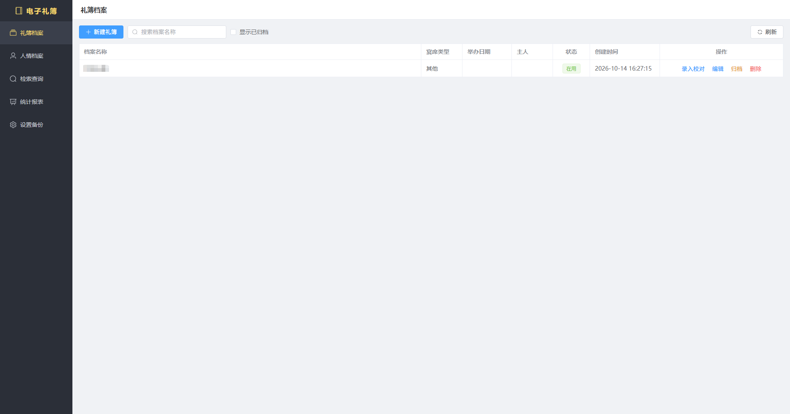
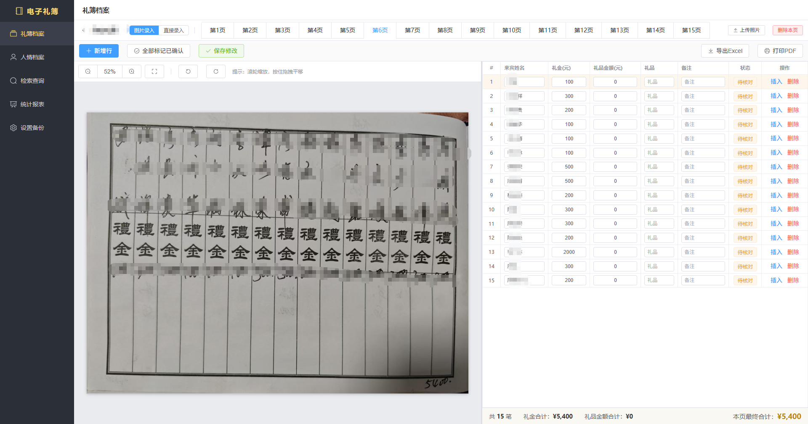
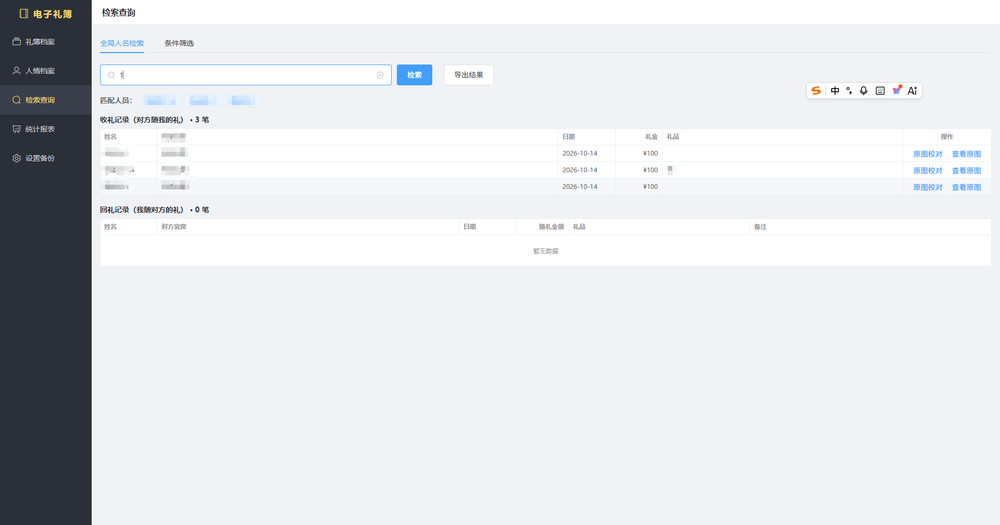
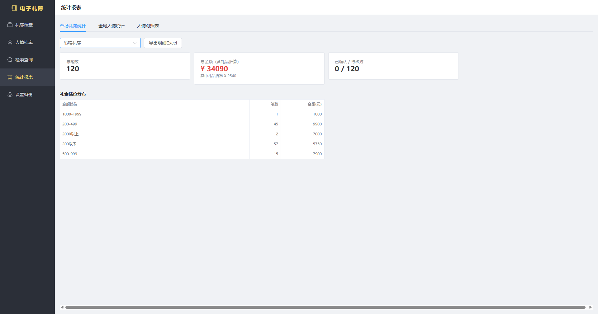
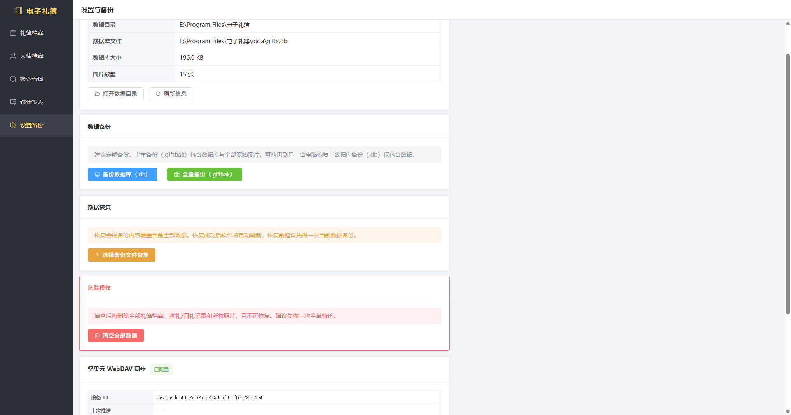
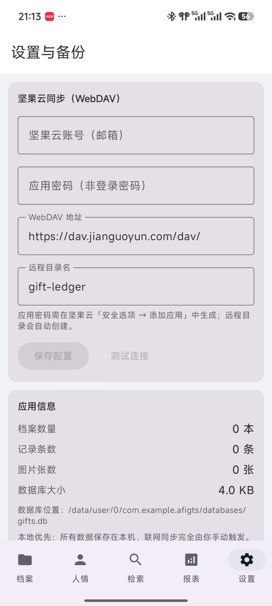

# 电子礼簿（Gift Ledger）

一款**本地优先**的电子人情礼簿应用，帮助你在婚宴、寿宴、满月酒等场合替代传统纸质礼簿：上传礼簿照片对照录入、自动汇总统计、管理人情往来，并支持桌面端与手机端数据互通。

所有数据默认完全保存在本地，离线可用；云端同步为可选功能（自行配置坚果云 WebDAV），不使用任何第三方云端 AI 服务，隐私完全掌握在自己手中。

## 功能特性

### 桌面端（Windows）
- **礼簿管理**：按场合（婚礼、寿宴等）创建多个礼簿，每个礼簿包含多页礼单
- **图片录入**：上传纸质礼簿照片，左侧对照原图、右侧逐行录入姓名与金额/礼品
- **图片旋转校正**：Rust 原生实现，直接修改图片文件
- **人员与人情往来**：按人归集收礼/回礼记录，查看每个人的人情明细
- **全局搜索**：跨礼簿搜索人名，可直接回看原始礼页图片
- **报表统计**：每页礼金汇总栏（现金合计 + 礼品折算 + 总计），支持导出 Excel / PDF
- **完整备份**：一键导出 `.giftbak`（ZIP 包，含数据库 + 全部图片），可在其他电脑完整恢复
- **坚果云 WebDAV 同步（可选）**：同步数据库与图片，实现桌面端与手机端数据互通

### Android 端
- 与桌面端一致的 UI 风格与图标（Element Plus 风格）
- 礼簿列表、礼页录入、人员编辑、搜索查看
- 搜索结果可点击查看原始礼页图片（可缩放预览）
- 坚果云 WebDAV 同步数据库（图片同步规划见 Roadmap）
- 无图片录入能力，使用「直接录入」模式

## 📥 下载安装包
> 最新版本：**v1.0.0**
- [Windows 桌面端（电子礼簿.exe）](https://github.com/finallyLover/gifts/releases/download/v1.0.0/default.exe)
- [Android 移动端（电子礼簿.apk）](https://github.com/finallyLover/gifts/releases/download/v1.0.0/default.apk)

### 使用说明
- Windows：下载后直接双击 exe 运行，无需安装
- Android：下载 apk 文件，在手机中允许安装未知来源应用即可安装


## 软件截图

### pc端

  

  

### 手机端

    

| 层 | 技术 |
| --- | --- |
| 前端 | Vue 3 + TypeScript + Element Plus + Pinia + Vite |
| 桌面壳 | Tauri 2.0（Rust） |
| 数据库 | SQLite（rusqlite bundled，WAL 模式） |
| 云同步 | reqwest + rustls，坚果云 WebDAV（Basic Auth 应用密码） |
| Android | Kotlin + Jetpack Compose（Android Studio 构建） |

## 目录结构

```
gifts/
├── src/                  # Vue3 前端（桌面端 UI）
├── src-tauri/            # Tauri Rust 后端（数据库、同步）
│   └── src/
│       ├── commands/     # Tauri 命令层
│       ├── db/           # SQLite schema 与迁移
│       └── sync.rs       # 坚果云 WebDAV 同步
├── AGifts/               # Android 工程（Kotlin + Jetpack Compose，自包含）
└── pc_build.bat          # 桌面端 NSIS 安装包构建脚本
```

## 构建与运行

### 环境要求
- Node.js 18+
- Rust 1.77.2+
- Android 构建：Android Studio（自带 JDK，无需 NDK）

### 桌面端开发

```bash
npm install
npm run tauri dev
```

### 桌面端打包（Windows 安装包）

```bat
pc_build.bat
```

产物位于 `src-tauri/target/release/bundle/nsis/`。

### Android 打包（APK）

用 Android Studio 打开 `AGifts/` 工程，直接 Build 即可出包，无需命令行脚本。

产物位于 `AGifts/app/build/outputs/apk/debug/app-debug.apk`。

> 注意：`pc_build.bat` 为纯 ASCII 编码，请勿在 .bat 文件中加入中文字符（Windows cmd 对 `chcp 65001` 下的中文批处理存在兼容性 bug，会导致脚本静默闪退）。

## 数据与隐私

- **本地优先**：SQLite 数据库 + 图片文件均保存在本机（桌面端存储于程序安装目录，支持便携使用；Android 存储于应用私有沙盒目录）
- **图片相对路径**：数据库只存相对路径（`images/{archive_id}/{uuid}.jpg`），方便跨机器备份恢复
- **可选同步**：坚果云 WebDAV 使用「邮箱 + 第三方应用密码」Basic Auth，仅传输你自己的数据库与图片
- **备份格式**：`.giftbak` 为 ZIP 包，包含完整数据库与图片，可跨设备完整还原

## Roadmap

- [ ] Android 端 images/ 目录同步（当前仅同步数据库，手机端暂无法查看原图）
- [ ] 更多报表维度

## 许可证

[MIT](LICENSE)

## 致谢

- [Tauri](https://tauri.app/) — 跨平台应用框架
- [Element Plus](https://element-plus.org/) — Vue 3 组件库
